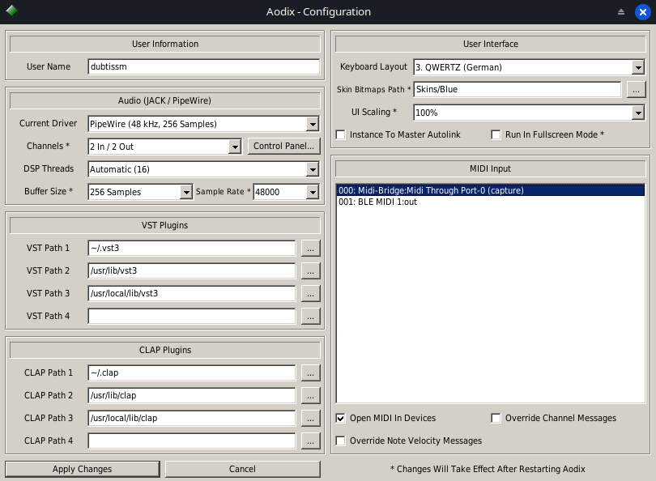

# Aodix für Linux

[](https://github.com/dubtissm/aodix-linux/actions/workflows/build.yml)
[](https://github.com/dubtissm/aodix-linux/releases/latest)
[](LICENSE)

[English](README.md) · **Deutsch**

**Aodix** ist der Tracker-/Sequencer-Hybrid von **Arguru Software**: ein Pattern-basierter Event-Editor,
kombiniert mit einem modularen Routing von Plugin-Instanzen. Dies ist eine native 64-bit-Linux-Version –
gleiche Oberfläche, gleiche Bedienung und gleiches Projektformat wie das Original, mit Audio über
JACK/PipeWire und den heutigen Linux-Plugin-Formaten.


## Funktionen

- **Natives 64-bit-Linux-Programm** (X11; unter Wayland über XWayland)
- **JACK und PipeWire** für Audio und MIDI – PipeWire funktioniert direkt, ohne `pw-jack`
- **Plugins:** VST3-, CLAP- und LV2-Instrumente und -Effekte mit eingebetteten Oberflächen, dazu LADSPA-Effekte
- **Mehrkern-Verarbeitung:** unabhängige Plugin-Ketten laufen parallel, mit bitgleichem Ergebnis
- **Skalierung** 100 / 150 / 200 % für hochauflösende Bildschirme, pixelscharf wie die Original-Skins
- **Tastatur-Layouts** QWERTY, QWERTZ und AZERTY für die Noteneingabe
- **Projekte:** öffnet originale `.adx`-Dateien; speichert komprimiert als `.adxl` (rund 10 KB statt 2,9 MB)
  oder als `.adx` für Aodix unter Windows
- Zwischenablage in allen Textfeldern, Debian-Paket mit Menüeintrag, Icon und Dateitypen

## Installation

**Debian, Ubuntu ab 22.04, Linux Mint, MX Linux, Xubuntu …** – das `.deb` aus dem
[neuesten Release](https://github.com/dubtissm/aodix-linux/releases/latest) herunterladen und installieren:

```bash
sudo apt install ./aodix_*_amd64.deb
```

Danach steht Aodix im Startmenü, und `.adx`-/`.adxl`-Projekte öffnen sich per Doppelklick. Für Audio wird
PipeWire mit JACK-Unterstützung (Paket `pipewire-jack`, auf den meisten aktuellen Systemen vorhanden) oder ein
JACK-Server (jack2) benötigt. LV2-Plugins brauchen `liblilv-0-0`.

**Andere Distributionen:** selbst bauen, siehe [Bauen](#bauen).

## Erste Schritte

- **Audio:** Aodix verbindet sich beim Start mit JACK oder PipeWire. Puffergröße und Samplerate für PipeWire
  stellt man unter *File → Configuration* ein (Voreinstellung 256 Samples, 48000 Hz). *Current Driver* zeigt,
  was benutzt wird, z. B. „PipeWire (48 kHz, 256 Samples)“. Startet man Aodix mit
  `PIPEWIRE_LATENCY=… pw-jack aodix`, haben diese Werte Vorrang.
- **Plugins:** Doppelklick auf einen leeren Platz in der Liste *VST Instance* öffnet die Plugin-Bibliothek –
  VST3-Plugins oben, CLAP, LV2 und LADSPA in eigenen Untermenüs. Doppelklick auf eine geladene Instanz öffnet
  ihre Oberfläche.
- **Plugin-Ordner:** VST3 wird in `~/.vst3`, `/usr/lib/vst3`, `/usr/local/lib/vst3` gesucht, CLAP in
  `~/.clap`, `/usr/lib/clap`, `/usr/local/lib/clap` (weitere Ordner unter *File → Configuration*). LV2- und
  LADSPA-Plugins werden an ihren Standardorten gefunden.
- **Routing:** Die Schaltfläche *vst routing* zeigt die modulare Ansicht: Audio- und MIDI-Kabel zwischen den
  Instanzen und dem Master-Ein- und -Ausgang, wie im Original.
- **MIDI-Eingang:** Port `Aodix:midi_in`; mit *Open MIDI In Devices* verbindet Aodix Hardware-MIDI-Quellen.
- **Hilfe:** *Help → Content* öffnet das Original-Handbuch.



Die Einstellungen liegen in `~/.config/aodix/Aodix.cfg`.

### Projektdateien (.adx / .adxl)

Eine `.adx`-Datei ist ein Speicherabzug von Aodix' Projektstruktur mit allen 256 Patterns, auch den leeren –
daher ist schon ein leeres Projekt 2,9 MB groß. `.adxl` ist derselbe Inhalt, gzip-komprimiert;
`gunzip -c projekt.adxl > projekt.adx` ergibt wieder eine originale `.adx`. *Save As* ohne Endung speichert
`.adxl`, mit der Endung `.adx` unkomprimiert; *Save* behält das Format der geöffneten Datei.

### Echtzeit-Priorität

Damit es keine Aussetzer gibt, laufen Aodix' Verarbeitungs-Threads mit Echtzeit-Priorität. Unter PipeWire holt
Aodix sie automatisch über RTKit. Erscheint im Terminal *„dsp worker threads could not get real-time priority“*,
Echtzeit für den eigenen Benutzer freischalten und danach ab- und wieder anmelden:

```bash
sudo usermod -aG audio $USER
printf '@audio - rtprio 95\n@audio - memlock unlimited\n' | sudo tee /etc/security/limits.d/95-audio.conf
```

Auf Debian-basierten Systemen mit jack2 richtet `sudo dpkg-reconfigure jackd2` (Echtzeit mit „Ja“ bestätigen)
dasselbe ein. `ulimit -r` zeigt die erlaubte Priorität (0 = keine). Aodix läuft auch ohne, kann unter Last aber
Aussetzer haben.

## Getestet mit

u-he Bazille (VST3 und CLAP, mit Oberfläche und GUI-Skalierung), u-he TetraOP, Signalizer, TAL-Plugins,
LoudMax (LADSPA), der swh-LADSPA-Sammlung, LV2-Effekten und den Beispiel-Plugins des VST3-SDK.

## Bekannte Einschränkungen

- Windows-Plugins (`.dll`), VST 2 und 32-bit-Plugins werden nicht unterstützt.
- LV2: nur X11-Oberflächen (Plugins mit reiner GTK-/Qt-Oberfläche bedient man über die Parameterliste);
  Presets aus dem Bundle werden nicht angezeigt; neu installierte LV2-Plugins erscheinen nach einem Neustart.
- CLAP: kein Preset-Browser, kein MPE, keine Note Expressions.
- Alte Windows-Projekte: Patterns, Events, Spuren und Marker werden geladen; Instanzen mit Windows-Plugins
  bleiben leer – dort die Linux-Version des Plugins laden (die Einstellungen müssen neu gemacht werden).
  Dateien älter als 4.2.0.3 enthalten keine Ersatzinformationen; dort bricht Aodix wie das Original das Laden
  der Instanzen beim ersten fehlenden Plugin ab.

## Bauen

Benötigt: C++17-Compiler, CMake ≥ 3.16, X11-, Xext- und zlib-Entwicklungspakete.

```bash
# Debian / Ubuntu / Mint
sudo apt install build-essential cmake libx11-dev libxext-dev zlib1g-dev
# Fedora
sudo dnf install gcc-c++ cmake libX11-devel libXext-devel zlib-devel
# Arch / Manjaro
sudo pacman -S base-devel cmake libx11 libxext zlib

git clone https://github.com/dubtissm/aodix-linux.git
cd aodix-linux
cmake -B build -DCMAKE_BUILD_TYPE=Release
cmake --build build -j
./build/aodix
```

`sudo cmake --install build` installiert Aodix systemweit. JACK und lilv werden erst zur Laufzeit geladen und
zum Bauen nicht gebraucht. Paket bauen, Releases, Aufbau des Quellcodes und Tests:
[docs/DEVELOPMENT.md](docs/DEVELOPMENT.md) (englisch).

## Geschichte und Credits

Aodix wurde von **Juan Antonio Arguelles Rius („Arguru“)** und **Zafer Kantar** entwickelt (Arguru Software,
bis Version 4.2.0.1), die Grafiken stammen von **Paul Merchant** und **Marc De Haar**. **J. van't Hoog** hat
Fehler behoben und es als [Aodix Enhanced](https://github.com/vanjac/aodix-enhanced) (4.2.0.3) weitergeführt.
Diese Linux-Version (4.2.1.x) entwickelt **Marcus Honnacker** zusammen mit Claude (Anthropic).
[Original-Website von Aodix (Archiv)](https://web.archive.org/web/20070819041559/http://www.aodix.com/pageaodixv4.html).

Die Projekt-Historie beginnt mit dem unveränderten Original-Quellcode; `git diff original -- src/aodix`
zeigt jede Änderung für Linux. Technische Notizen zur Portierung: [docs/PORTIERUNG.md](docs/PORTIERUNG.md).

## Lizenz

MIT wie das Original (siehe [LICENSE](LICENSE)). Enthaltener Fremdcode: Teile des Steinberg VST3-SDK (MIT),
die CLAP-Header (MIT) und die LV2-Header (ISC); die Oberflächenschrift ist aus DejaVu Sans Condensed gerendert.
VST ist eine Marke der Steinberg Media Technologies GmbH.
