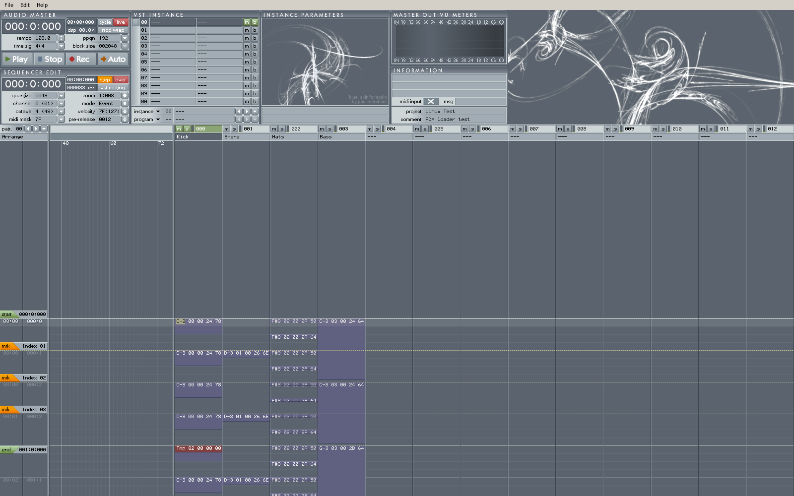
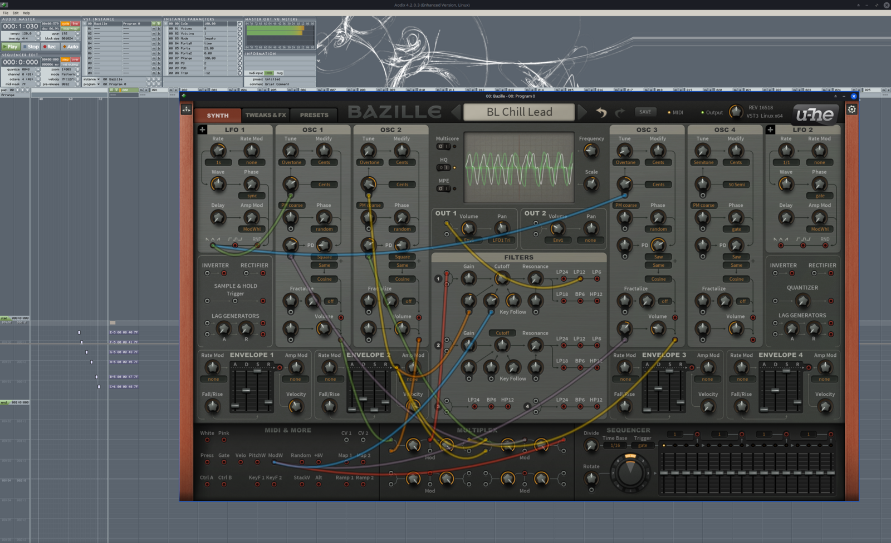

# Aodix für Linux (64-bit)

Portierung des Musik-Sequencers **Aodix 4.2.0.3** von Arguru Software auf Linux, basierend auf
[Aodix Enhanced](https://github.com/vanjac/aodix-enhanced). Das Programm soll so originalgetreu wie
möglich bleiben: gleiche Oberfläche, gleiche Bedienung, gleiches Projektformat (`.adx`).

Ziele der Portierung:

- natives 64-bit-Linux-Programm (X11, unter Wayland über XWayland)
- **JACK** statt ASIO für Audio und MIDI
- **VST3**-Plugins (64-bit Linux), später eventuell CLAP
- alte `.adx`-Projekte bleiben lesbar und werden im selben Format gespeichert



## Stand

| Etappe | Inhalt | Status |
|---|---|---|
| 1 | 64-bit-Linux-Build, X11-Oberfläche, Projekte laden/speichern | ✅ fertig |
| 2 | JACK-Audio und JACK-MIDI | ✅ fertig |
| 3 | Feinschliff der Oberfläche (Zwischenablage, Tastatur-Layouts, HiDPI) | offen |
| 4 | VST3-Hosting inklusive Plugin-Editoren | ✅ fertig |
| 5 | Installation, Paketierung, CLAP (optional) | offen |

Die komplette Oberfläche läuft (Sequencer, Routing, Menüs, Dialoge), Projekte werden geladen und
gespeichert, Audio und MIDI laufen über JACK, Bounce schreibt WAV-Dateien, und 64-bit-**VST3**-Plugins
werden geladen – mit Parametern, Programmen, MIDI, Zustand im Projekt und eingebettetem Plugin-Editor.

## Audio und MIDI (JACK)

Aodix verbindet sich beim Start mit einem laufenden JACK-Server. Das funktioniert mit jack2 (z. B. über
QjackCtl gestartet) und mit PipeWire. Falls Aodix unter PipeWire keine Verbindung bekommt, mit
`pw-jack ./build/aodix` starten. Zum Bauen wird JACK nicht benötigt, die Bibliothek wird erst zur
Laufzeit geladen.

- **Ports:** `Aodix:out_1 …` und `Aodix:in_1 …` werden beim Start mit den Hardware-Ports verbunden.
  Die Anzahl (2/4/8/16/32) stellt man unter *File → Configuration → Channels* ein (wirkt nach Neustart).
  Welche JACK-Ports zu welchem Master-Pin gehören, wählt man wie im Original per Klick auf die Pins der
  Master-Input/Output-Module in der Routing-Ansicht.
- **Samplerate und Puffergröße** gibt der JACK-Server vor (Anzeige *block size* im Audio-Master).
- **MIDI:** Eingang `Aodix:midi_in`. Ist *Open MIDI In Devices* aktiv, verbindet Aodix alle Hardware-MIDI-
  Quellen automatisch (unter jack2 ggf. `a2jmidid -e` für ALSA-MIDI-Geräte starten).
- Wird der JACK-Server beendet, meldet Aodix das; nach dem Neustart von JACK den Treiber unter
  *File → Configuration* erneut übernehmen.

## VST3-Plugins

- **Suchpfade:** Voreingestellt sind die Standardorte `~/.vst3`, `/usr/lib/vst3` und `/usr/local/lib/vst3`.
  Weitere Ordner lassen sich unter *File → Configuration → VST Plugins* eintragen (Unterordner werden
  durchsucht). Ein Bundle mit mehreren Plugins (z. B. mda-vst3) erscheint in der Bibliothek als Untermenü.
- **Laden:** wie im Original per Doppelklick auf einen leeren Instanz-Platz; Doppelklick auf eine geladene
  Instanz öffnet den Plugin-Editor. Ist *Instance To Master Autolink* aktiv, wird eine neue Instanz direkt mit
  dem Master-Ausgang verbunden.
- **MIDI:** Noten, Controller, Pitchbend, Aftertouch und Programmwechsel werden in VST3-Ereignisse bzw.
  Parameter übersetzt (über das `IMidiMapping` des Plugins). MIDI-Ausgaben eines Plugins kommen wie im
  Original im Routing an.
- **Parameter und Automation:** Knopfbewegungen im Plugin-Editor erscheinen in der Parameterliste und
  können aufgenommen werden. Programme kommen aus der Programmliste des Plugins (falls vorhanden).
- **Projekte:** Der vollständige Plugin-Zustand (Prozessor + Controller) wird im `.adx` gespeichert. Die Plugin-
  Klasse wird über eine aus der VST3-Klassen-ID abgeleitete 32-bit-ID wiedergefunden, das Bundle notfalls
  über seinen Namen in den Suchpfaden (Projekte lassen sich also auf einen anderen Rechner mitnehmen).
- **Editoren:** Die Plugin-Oberfläche wird in das Aodix-Instanzfenster eingebettet (X11). Plugins, die ihre
  Größe ändern wollen oder frei skalierbar sind, werden unterstützt.
- Windows-Plugins (`.dll`) und VST 2 werden nicht geladen.

Getestet mit u-he **Bazille** (Vollversion, VST3 Linux x64) inklusive Editor, den Beispiel-Plugins des VST3-SDK
(u. a. mda JX10, ADelay) und einem eigenen Test-Instrument mit Editor (`tests/vst3_test_synth`).



## Bauen

Benötigt: C++17-Compiler, CMake ≥ 3.16, X11- und Xext-Entwicklungspakete.

```bash
# Debian / Ubuntu / Mint
sudo apt install build-essential cmake libx11-dev libxext-dev

# Fedora
sudo dnf install gcc-c++ cmake libX11-devel libXext-devel

# Arch / Manjaro
sudo pacman -S base-devel cmake libx11 libxext
```

```bash
cd aodix_linux
cmake -B build -DCMAKE_BUILD_TYPE=Release
cmake --build build -j
./build/aodix                  # oder: ./build/aodix projekt.adx
```

Die Skins und die Hilfe werden beim Bauen neben das Programm kopiert. Mit `cmake --install build` wird
Aodix systemweit installiert (Programm, Skins, Hilfe, Desktop-Eintrag).

Optional für native Dateidialoge: `zenity` (GNOME/GTK) oder `kdialog` (KDE). Ohne diese Programme
verwendet Aodix einen eingebauten Dateidialog.

## Wo liegt was?

- Einstellungen: `~/.config/aodix/Aodix.cfg` (gleiches Binärformat wie unter Windows)
- Skins: `Skins/Blue`, `Skins/Night` neben dem Programm (oder `share/aodix/Skins`)
- Hilfe: Menü *Help → Content* öffnet die HTML-Hilfe im Browser

## Aufbau des Quellcodes

```
src/aodix/      Original-Programmcode von Aodix (nur dort geändert, wo die Portierung es erfordert)
src/argulib/    Arguru-Hilfsbibliothek (Original)
src/platform/   Win32-Kompatibilitätsschicht auf X11 (Zeichnen, Fenster, Menüs, Dialoge)
src/plugin/     Plugin-Schnittstelle (AdxPlugin) und VST3-Host (plugin_vst3.cpp)
third_party/    benötigter Teil des VST3-SDK 3.8 (MIT-Lizenz)
tests/          Test-Plugin für den VST3-Host
resources/      Skins, Hilfe, Icon, Desktop-Eintrag
docs/           Dateiformat, Portierungsnotizen
```

Die Details zur Portierung stehen in [docs/PORTIERUNG.md](docs/PORTIERUNG.md).

## Git-Historie

Die Versionsgeschichte beginnt mit dem unveränderten Original-Quellcode, sodass jede Änderung der
Portierung nachvollziehbar ist. Sie liegt als Datei `aodix-git-history.bundle` bei. Einmalig einrichten:

```bash
cd aodix_linux
git init -b main
git fetch ./aodix-git-history.bundle main
git reset FETCH_HEAD
git log --oneline          # zeigt die Etappen
git diff 77e4cf3 -- src/aodix   # alle Änderungen am Original-Aodix-Code
```

## Lizenz

MIT-Lizenz wie das Original (siehe `LICENSE`). Aodix wurde von Juan Antonio Arguelles Rius („Arguru“)
und Zafer Kantar entwickelt, die Grafiken stammen von Paul Merchant und Marc De Haar; weitere Arbeiten von
J. van't Hoog (Aodix Enhanced). Die eingebettete Oberflächenschrift ist aus DejaVu Sans Condensed
gerendert (freie Bitstream-Vera-/DejaVu-Lizenz). Der mitgelieferte Teil des VST3-SDK von Steinberg steht
unter der MIT-Lizenz (`third_party/vst3sdk/LICENSE.txt`); VST ist eine Marke der Steinberg Media Technologies GmbH.
